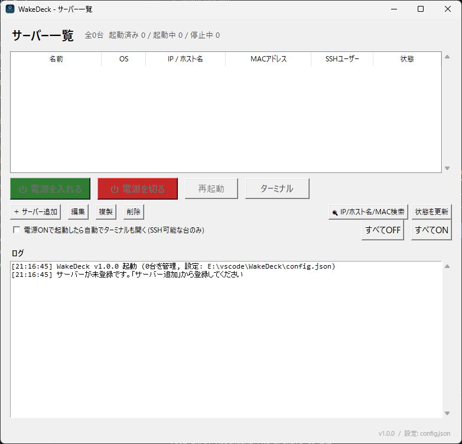

# WakeDeck

**ローカルLAN内の Ubuntu Server の電源を、Windowsからワンクリックで操作するツールです。**
毎回 Wake on LAN パケットを手で送ったり、SSH で `sudo poweroff` を打ったりする手間をなくします。



- **電源を入れる**: Wake on LAN マジックパケットを送信し、設定された管理ポートまたはpingで起動を確認
- **電源を切る**: LinuxはSSHで `sudo poweroff`、Windowsは設定方式（SSH/RPC）で実行し、停止を確認（GUIは確認ダイアログ付き）
- **再起動**: SSHまたはRPCで再起動を実行し、一度停止してから再び応答するまで自動確認
- **状態表示**: ping と設定された管理ポート（SSHは設定ポート、Windows RPCは445番）で状態を自動判定し、数秒ごとに更新

GUI（Tkinter）と CLI の両対応です。ショートカットやタスクスケジューラからも使えます。

**複数サーバーを一覧で管理できます。** 登録した全サーバーの状態が一覧に色付きで並び（起動済み=緑 / 起動中=橙 / 停止中=グレー）、1台ずつの操作のほか、複数選択してまとめてON/OFFしたり、「すべてON」「すべてOFF」で一括操作したりできます。

**Windows の PC も対象にできます。** 一覧に OS 列が付き、登録時に OS種別（Ubuntu / Linux か Windows）を選ぶだけです。電源ONは Linux と同じ WoL、電源OFFは方式が2つあります（下の「Windows PC を対象にする場合」参照）。

**ネットワーク検索ができます。** IPアドレス / ホスト名 / MACアドレス の相互解決と、LAN内スキャン（/24 の機器一覧）ができます。検索結果やスキャン結果からそのままサーバー登録できるので、追加時に MAC を調べに行く手間がなくなります（下の「ネットワーク検索」参照）。

**SSHターミナル連携があります。** 選択したサーバーへの SSH接続を Windows Terminal で開けます（下の「SSHターミナル」参照）。

**「監視のみ」モードがあります。** SSH も RPC も有効化されていない機器でも、IP と MAC だけで登録して WoL 起動と状態表示ができます（下の「SSH/RPC の無い機器（監視のみ）」参照）。

## 使い方（Windows）

### 1) Ubuntu Server 側の準備（最初に1回だけ）

**すでに WoL で起こせていて、SSH から `sudo poweroff` もできているサーバーは、この手順は不要です。** WakeDeck はサーバー側に何もインストールせず、いま手動でやっている WoL パケット送信と SSH 操作をそのまま自動化するだけです。対象サーバーの IP / MAC / SSH 情報を GUI に登録するだけで使えます（複数台ある場合は台数分登録してください）。

新規に立てるサーバーの場合は以下を行ってください。

BIOS/UEFI で Wake on LAN を有効にしてください（マザーボードにより `Power On By PCI-E` / `Wake on LAN` などの表記）。

次にサーバー上で以下を実行します。

```bash
sudo bash ubuntu/setup_wol.sh
```

このスクリプトがやること:

1. `ethtool -s <IF> wol g` で WoL を有効化し、再起動後も維持される systemd サービス（`wol.service`）を登録
2. SSHサーバーが動いていない場合は `openssh-server` の導入方法を表示
3. Windows側の設定に入れる値（IPアドレス / MACアドレス / SSHユーザー名）を表示

推奨: ルーターのDHCP固定割当でサーバーのIPを固定してください（IPが変わるとWoLのブロードキャスト推定とSSH接続先がずれます）。

### 2) Windows 側の起動

```bat
install_and_run.bat
```

- Python 3.11以上が必要です（なければ https://www.python.org/downloads/ から導入し、インストール時に `Add python.exe to PATH` にチェック）
- `paramiko` が無ければ自動で `pip install -r requirements.txt` します
- 起動後は `start.bat` だけで開けます（`WakeDeck.exe` があればそちらを優先して起動します）

exe化したい場合は `build_exe.bat` を実行してください。PyInstaller で単一ファイルの `WakeDeck.exe` を作ります（`config.json` は exe と同じフォルダに保存されます）。
アプリのウィンドウと exe には WakeDeck の電源・サーバーをモチーフにしたアイコンを使用します。

### 3) 設定（サーバーの追加・編集）

初回起動時は空の一覧が表示されます。一覧下の「＋ サーバー追加」から登録してください。行を選んで「編集」ボタン（またはダブルクリック）で変更、「複製」「削除」も一覧下のボタンから行えます。各サーバーごとに以下の項目を持ちます。

| 項目 | 説明 |
|---|---|
| 表示名 | 一覧に出る名前（例: `メインサーバー`、`ファイルサーバー`） |
| OS種別 | `Ubuntu / Linux` か `Windows` |
| 電源OFF方式 (Windows対象のみ) | `SSH (OpenSSHサーバー)` か `RPC (shutdownコマンド)`。下記参照 |
| 対象のIP / ホスト名 * | 例: `192.0.2.10` |
| MACアドレス * | 例: `02:00:00:00:00:01`（`:` / `-` / なし、どれでも可） |
| ブロードキャスト | 空欄ならIPから `/24` で自動推定（例: `192.0.2.255`） |
| WoLポート | 初期値 `9` |
| SSHユーザー名 * | 例: `your_user` |
| SSHポート | 初期値 `22` |
| SSHパスワード | SSH認証に使用します。Linuxでは電源操作時の `sudo -S` にも使用します。WindowsではDPAPIで暗号化して保存し、暗号化に失敗した場合は保存を中止します（同じWindowsユーザーでのみ復号可能） |
| 秘密鍵ファイル (任意) | 指定すると鍵認証を優先します |

追加/編集ダイアログには「SSH接続テスト」「WoL送信テスト」ボタンがあります（WoLテストはサーバーが起きていても害はありません）。

一覧での操作:

- 1台（または Ctrl/Shift+クリックで複数台）を選んで「電源を入れる」「電源を切る」「再起動」
- 「すべてON」「すべてOFF」は登録済みの制御可能な台が対象（すでに起動済み/停止中の台と監視のみの台は自動でスキップされます）
- 状態は数秒ごとに全台まとめて自動更新されます。手動更新は「状態を更新」ボタン
- GUIのログ欄は直近2000行を表示します

手動で設定する場合は `config.example.json`（v2形式: `{"version": 2, "servers": [...]}`）を `config.json` としてコピーして編集してください（パスワードは平文ではなく `ssh_password_protected` に暗号化済みの値を入れる必要があります。GUIからの保存が確実です）。

## SSH/RPC の無い機器（監視のみ）

SSHサーバーも RPC も有効化されていない機器（ゲーム用PC、検証機など）は、**SSHユーザー名を空のまま** 登録してください。SSHユーザー名が空のサーバーは自動的に「監視のみ」になります（チェックボックスは廃止。Windows + RPC方式は SSHユーザーが無くても電源操作できるため例外）。

- 登録に必要なのは **IPアドレスと MACアドレスだけ**（SSHユーザー不要）。一覧では SSHユーザー欄に「(監視のみ)」と表示されます
- **WoL で電源ON** できます（起動確認は ping / 状態確認用ポートで行います）
- **状態表示**: 既定は ping 応答で 起動済み/停止中 を判定します。「状態確認用ポート」に開いているポート（例: RDP の 3389、SMB の 445）を指定すると、そのポートで判定でき、ping に応答しない機器でも正確に判定できます
- **できないこと**: 電源OFF / 再起動 / SSHターミナル（ネットワーク経由で切る手段が無いため）。「すべてOFF」の対象からも自動で外れます

注意: Windows PC はファイアウォール設定によって ping に応答しないことがあります。その場合は状態確認用ポート （例 3389）を指定してください。

## Windows PC を対象にする場合

電源ON (WoL) は Linux と同じ仕組みですが、Windows PC 側には特有の前提があります。

**電源ONの前提 (両方式共通)**
1. BIOS/UEFI で Wake on LAN を有効化
2. デバイスマネージャー → ネットワークアダプター → プロパティ:
   - 「詳細設定」で **Wake on Magic Packet** を有効に
   - 「電源の管理」で **「このデバイスで、コンピューターのスタンバイ状態を解除できるようにする」** と **「Magic Packet のみで解除」** にチェック
3. **高速スタートアップを無効化**（コントロールパネル → 電源オプション → 電源ボタンの動作を選択する → 「高速スタートアップを有効にする」のチェックを外す）。これが有効だとシャットダウンがハイブリッド化され、**シャットダウン状態から WoL で起きない** ことがほとんどです（スリープからは起きます）
4. MACアドレスは対象PCで `ipconfig /all` の「物理アドレス」

**電源OFF方式A: SSH (推奨)**
対象PCに Windows 標準の OpenSSH サーバーを入れます。管理者 PowerShell で:

```powershell
Add-WindowsCapability -Online -Name OpenSSH.Server~~~~0.0.1.0
Start-Service sshd
Set-Service -Name sshd -StartupType Automatic
```

WakeDeck 側は OS種別=Windows / 方式=SSH にして、対象PCの管理者ユーザーの ID とパスワードを登録します（Microsoft アカウントの場合は PIN ではなくパスワードで認証します）。内部では SSH で `shutdown /s /t 0 /f`（再起動は `/r`）を実行します。状態判定は SSH ポート (22) で行います。

**電源OFF方式B: RPC (対象側に何も入れたくない場合)**
WakeDeck を実行している Windows の標準機能 `shutdown /m \\対象 /s /t 0 /f` を使うので、対象側へのインストールは不要です。その代わり Windows のリモート管理の制約を受けます:

- 実行ユーザーと **同じユーザー名・同じパスワードの管理者アカウント** が対象PCにも必要（ワークグループの場合。ドメイン環境ならドメイン管理者で可）
- 対象PCのファイアウォールで「ファイルとプリンターの共有」を許可（状態判定も SMB ポート 445 で行います）
- ローカル管理者アカウントでは UAC のリモート制限で弾かれることがあります。その場合は対象PCの管理者 PowerShell / レジストリで `LocalAccountTokenFilterPolicy` (DWORD) = 1 を `HKLM\SOFTWARE\Microsoft\Windows\CurrentVersion\Policies\System` に追加してください
- 事前確認として、操作側のコマンドプロンプトで `shutdown /m \\192.0.2.30 /s /t 60` が通るか試すのが確実です（`/a` と `/m` の併用で、60秒以内なら `shutdown /a /m \\192.0.2.30` で取り消せます）

RPC方式では SSH ユーザー登録は不要です。

## ネットワーク検索

一覧下の「🔍 IP/ホスト名/MAC検索」ボタンから使えます。CLI は `--lookup` / `--scan` です。

| やりたいこと | 方法 | 仕組み |
|---|---|---|
| IP → ホスト名 | IPを入れて検索 | OSの逆引き解決 (DNS / hosts / NetBIOS等) |
| ホスト名 → IP | ホスト名を入れて検索 | OSの正引き解決 (DNS / mDNS の `.local` 含む) |
| IP → MAC | IPを入れて検索 | ping で ARPキャッシュを作ってから `arp -a` を読む。**同一サブネット内のみ** |
| MAC → IP | MACを入れて検索 | ARPキャッシュに無ければ自分のサブネット (/24) を ping スイープして ARP から探す。プロトコルに逆引きが無いため、この方法が実質唯一の手段 |
| LAN内の機器一覧 | ダイアログ下段「スキャン開始」 | /24 を一斉 ping → ARPテーブルを一覧化し、ホスト名の逆引きと登録済みチェック (「済」表示) 付きで表示 |

検索結果の「この情報でサーバー追加」、スキャン結果の行ダブルクリックで、IP/MAC/ホスト名が入力済みの追加ダイアログが開きます。

限界も正直に: 別サブネット (ルーター越え) の機器の MAC は引けません（見えるのはルーターの MAC だけ）。電源が切れている機器は ARP にも応答も無いため、MAC→IP 検索やスキャンでは見つかりません（IP→MAC も、ARPキャッシュに残っている間のみ引けます）。

```powershell
python wake_deck.py --lookup 192.0.2.10       # IPから ホスト名/MAC を引く
python wake_deck.py --lookup server.example    # ホスト名から IP/MAC を引く
python wake_deck.py --lookup 02:00:00:00:00:01  # MACから IP/ホスト名 を引く (必要なら自動スキャン)
python wake_deck.py --scan                    # 自分のサブネットの機器一覧
python wake_deck.py --terminal --server メイン  # SSHターミナルを開く (複数台は --all / タブで並ぶ)
```

## SSHターミナル

一覧でサーバーを選ぶと「ターミナル」ボタンが有効になります（起動済みの台のみ）。内部では Windows Terminal で `ssh ユーザー@ホスト -p ポート` を開きます。

- **複数選択対応**: 複数台を選ぶと、1つの Windows Terminal ウィンドウにタブで並べて開きます
- **フォールバック**: Windows Terminal が無い環境では PowerShell → cmd の順に試します（台ごとに別ウィンドウ）
- **自動オープン**: 一覧下の「電源ONで起動したら自動でターミナルも開く」をONにすると、電源ONして起動確認が取れたタイミングで自動的にターミナルが開きます。複数台を一括ONした場合は、全台ぶんを1ウィンドウのタブにまとめて開きます。設定は `config.json` に保存されます
- **対象外**: RPC方式の Windows (SSHサーバーが無い前提) と SSHユーザー未設定の台は開けません
- CLI: `python wake_deck.py --terminal --server メイン` / `--terminal --all`

**パスワードについて（重要）**: 保存済みの SSHパスワードをターミナルの `ssh` に渡す安全な方法は無いため、パスワード認証の台では開いたターミナルでパスワード入力が必要です。鍵認証の台はそのままログインまで進みます。

**鍵認証への移行**: サーバーの追加/編集ダイアログにある「🔑 公開鍵を登録」ボタンで、この端末の公開鍵を対象の `~/.ssh/authorized_keys` に SFTP で登録できます。既存の `id_ed25519` / `id_ecdsa` / `id_rsa` 鍵があれば再利用し、いずれも無ければ `id_ed25519` を自動生成します。接続には設定済みのSSH認証（パスワード、秘密鍵、またはSSHエージェント）が使われます。登録後に「保存」すると秘密鍵パスが設定され、以降ターミナルはパスワードなしで開きます。注意: Windows対象で管理者ユーザーの場合、OpenSSH は `C:\ProgramData\ssh\administrators_authorized_keys` を参照するため、その場合はそちらへの登録が別途必要です。

## CLI

```powershell
python wake_deck.py --list                       # 登録サーバーと状態を一覧表示
python wake_deck.py --status                     # 全サーバーの状態を表示
python wake_deck.py --on --server メイン          # 名前(部分一致可)で1台を指定
python wake_deck.py --off --server 2             # --list の番号でも指定できる
python wake_deck.py --off --all                  # 全台を電源OFF
python wake_deck.py --on                         # 登録が1台だけなら対象指定は不要
python wake_deck.py --reboot --server ファイル
python wake_deck.py --on --no-wait               # 操作後の状態遷移を待たない
python wake_deck.py --config C:\path\to\config.json   # 設定ファイルを指定
```

複数台が登録されている状態で `--on/--off/--reboot` に対象指定（`--server` / `--all`）が無い場合は、誤操作防止のためエラーになり一覧を表示します。

## 仕組み

- **WoL**: マジックパケット（`FF×6 + MAC×16`、SecureOnパスワード指定時は+6バイト）を、ブロードキャスト / `255.255.255.255` / サーバーIPの複数宛先へ3回送信します
- **電源OFF/再起動 (Linux)**: `paramiko` でSSH接続し、パスワードがある場合は `sudo -S` でパスワードを渡して `poweroff` / `reboot` を実行します。パスワードが無い場合は `sudo -n`（パスワードなしsudo設定が前提）になります
- **電源OFF/再起動 (Windows)**: SSH方式は OpenSSH サーバーへ接続して `shutdown /s|/r /t 0 /f`、RPC方式は操作側の `shutdown.exe /m` で実行します
- **paramiko が無い場合**: OSにインストールされた OpenSSH クライアント（Windowsでは `ssh.exe`）へフォールバックします。パスワード認証は使えず、Linuxの電源操作ではパスワードなしsudoが前提です
- **状態判定**: ping と管理ポート（SSH方式は設定したSSHポート / RPC方式は445番）の応答で判定します。監視のみは指定ポート、またはポート未指定ならpingで判定し、GUIは `check_interval_sec`（初期値4秒）ごとに全台を確認します

## うまく動かないとき

| 症状 | 対処 |
|---|---|
| WoLで起きない | BIOS/UEFIのWoL設定を確認。サーバー上で `ethtool <IF> \| grep -i wake` が `g` を含むか確認（`setup_wol.sh` を再実行）。同じLAN内か、MACアドレスが正しいか、IPがDHCPで変わっていないかも確認 |
| `sudo のパスワード認証に失敗しました` | 設定のSSHパスワードを確認するか、サーバー側でパスワードなしsudoを設定してください。`sudo visudo` に以下を追加: `USER ALL=(ALL) NOPASSWD: /usr/sbin/poweroff, /usr/sbin/reboot` |
| `paramiko が無いため ssh.exe で代替` と出て電源OFFできない | `pip install paramiko` を入れるか、鍵認証 + パスワードなしsudoを設定してください（上記参照） |
| Windows PC がシャットダウンから WoL で起きない | 高速スタートアップが有効だと起きません（無効化は上記参照）。スリープからは起きるかも併せて確認を。NICドライバの Wake on Magic Packet 設定も要確認 |
| Windows対象で電源OFFが「アクセスが拒否」 | SSH方式: 対象側のユーザーが管理者かどうか、パスワード認証できているか。RPC方式: 同一資格情報の管理者アカウント、445到達性、`LocalAccountTokenFilterPolicy` を確認 |
| 電源OFF後も「まだ応答があります」 | シャットダウン完了まで最大90秒待ちます。もう少し待つか「状態を確認」で再確認してください |
| 再起動の完了を確認できない | 再起動は落ちてから戻るまで最大210秒待ちます。サーバーの起動が遅い場合はそのまま待って「状態を確認」してください |

## テスト

```bash
python tests/test_core.py   # MAC解析 / マジックパケット / 設定の往復 / TCP判定 / v2形式の往復 / サーバー検索 / Windows対象のコマンド生成・方式別ポート判定 / ARP出力パース / 入力種別判定など
```

GUI は仮想ディスプレイ (Xvfb) 上での起動スモークテスト（2台登録時・0台時とも）も確認済みです。

## ファイル構成

```
WakeDeck/
  wake_deck.py          # 本体（GUI + CLI）
  README.md             # このファイル
  config.example.json   # 設定の雛形（config.json としてコピーして使う）
  screenshot.png        # アプリ画面
  requirements.txt      # paramiko
  install_and_run.bat   # 初回セットアップ + 起動
  start.bat             # 起動（exeがあれば優先）
  build_exe.bat         # PyInstallerで WakeDeck.exe をビルド
  assets/wakedeck.svg   # アプリアイコンの編集用ベクター原稿
  assets/wakedeck.ico   # GUI / exe 用アイコン
  assets/wakedeck.png   # Tkinter ウィンドウ用アイコン
  ubuntu/setup_wol.sh   # Ubuntu側のWoL有効化スクリプト
  tests/test_core.py    # 単体テスト
```

## ライセンス

MIT License（詳細は同梱の `LICENSE` ファイル参照）。利用しているライブラリ: paramiko。
